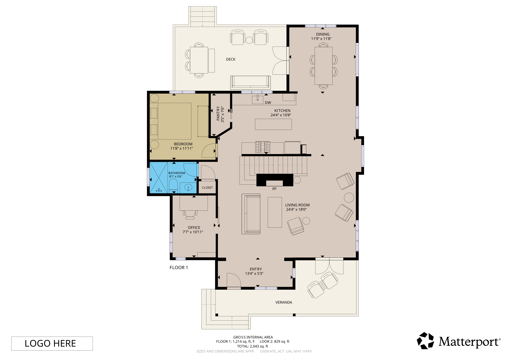
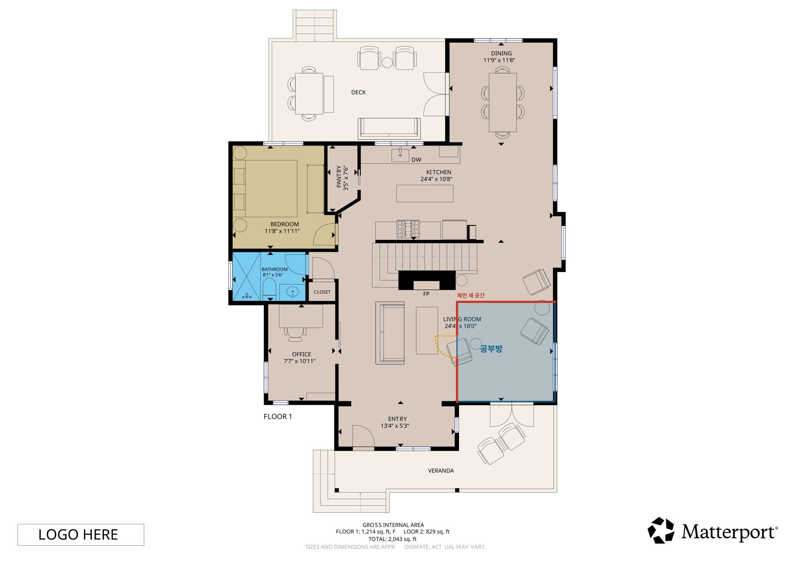
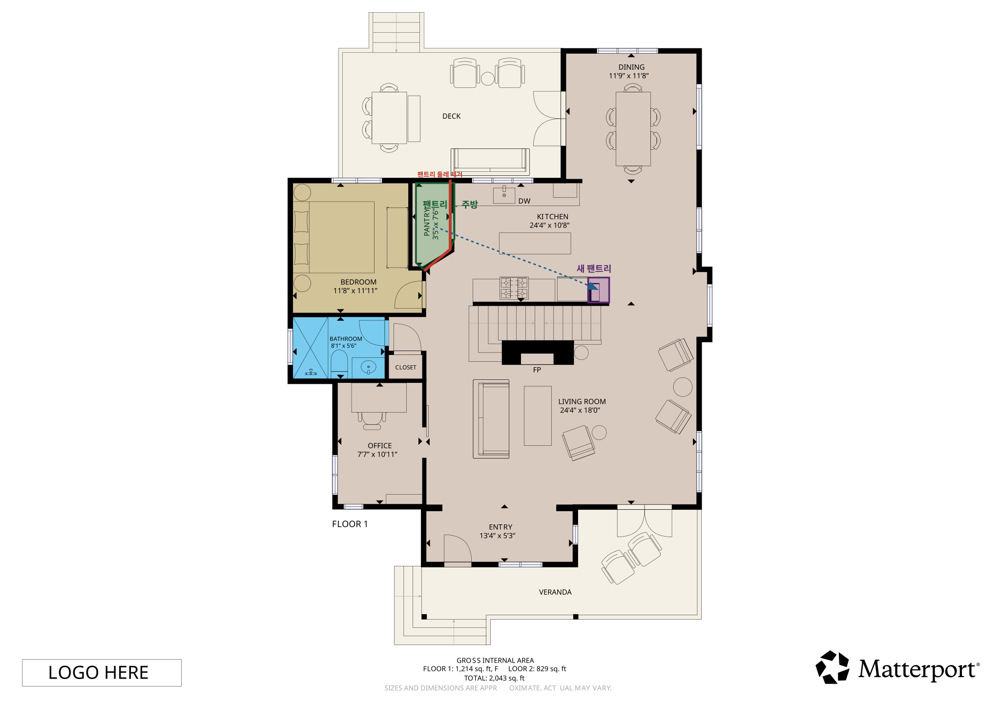
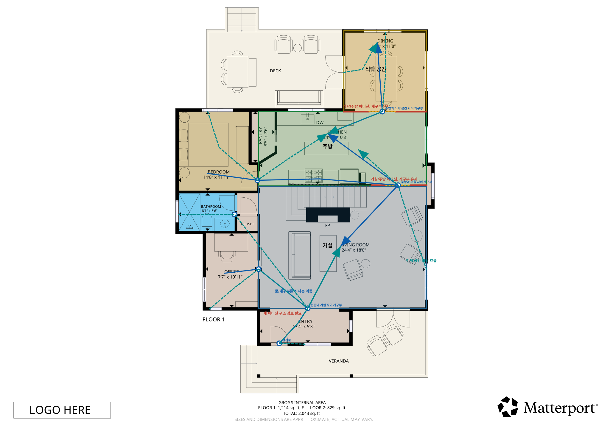

# Floorplan Ontology Skill

Codex에 설치하고 말로 시키면, SVG 평면도를 바로 분석해서 공간/벽/문/창문 엔티티와 공사 제안 리포트를 만들어주는 스킬입니다.

예를 들어 이렇게 요청할 수 있습니다.

```text
이 SVG 평면도에서 거실을 분할해 공부방을 만들고,
출입구를 막지 않는지 확인한 뒤 HTML 리포트로 보여줘.
```

스킬은 원본 SVG를 보존하면서 추출 결과와 공사 제안을 `overlay.svg`와 `report.html`로 만들어 줍니다. HTML 리포트에는 SVG가 파일 링크가 아니라 `<svg>...</svg>`로 직접 포함되어 있어 브라우저에서 단독으로 열 수 있습니다.

## Demo

### 원래 도면



### 공사 요청 3건 비교

| 요청 | 말로 시키는 예 | 결과 이미지 |
| --- | --- | --- |
| 거실 일부를 공부방으로 분할 | `거실 공간을 분할하여 공부방을 만들어줘. 출입구는 막지 마.` |  |
| 팬트리를 주방으로 전환하고 팬트리 재배치 | `팬트리를 없애고 주방으로 바꿔주고, 팬트리는 주방 가까운 곳에 다시 설치해줘.` |  |
| 주방, 식탁 공간, 거실 분리 + 동선/바람 표시 | `주방과 식탁을 별도 공간으로, 거실은 독립 공간으로 만들고 이동 화살표와 바람 흐름도 표시해줘.` |  |

자세한 비교는 [공사 요청 비교 문서](docs/proposal-comparison.md)를 보세요.

## What It Produces

```text
vector_nodes.json
labels.json
entities.json
relations.json
debug_report.md
overlay.svg
report.html
study_room_report.html
kitchen_pantry_report.html
zoned_living_kitchen_dining_report.html
```

핵심 산출물:

- `vector_nodes.json`: SVG 원소별 벡터 노드, bbox, centroid, style, 후보 카테고리.
- `labels.json`: 병합된 텍스트 라벨, 방 이름, 치수 텍스트, anchor, 연결 entity.
- `entities.json`: 공간, 벽, 문, 창문, 설비, 주석 entity.
- `relations.json`: contains, locatedIn, boundedBy, locatedOn, connects, opensInto 관계.
- `report.html`: 한국어 요약 테이블과 inline SVG 검증 뷰.
- `*_proposal.json`: 공사 요청별 구조화된 제안 데이터.
- `*_overlay.svg`: 원본 도면 위에 공사 제안과 분석 화살표를 덧그린 검증 이미지.

## Install In Codex

1. 이 repo를 받습니다.
2. `skills/floorplan-ontology` 폴더를 Codex skills 경로로 복사합니다.

```bash
mkdir -p "${CODEX_HOME:-$HOME/.codex}/skills"
cp -R skills/floorplan-ontology "${CODEX_HOME:-$HOME/.codex}/skills/floorplan-ontology"
```

또는 압축 파일을 받아 설치할 수 있습니다.

```bash
unzip releases/floorplan-ontology-skill.zip -d "${CODEX_HOME:-$HOME/.codex}/skills"
```

필요한 Python 의존성을 설치합니다.

```bash
python3 -m pip install -r "${CODEX_HOME:-$HOME/.codex}/skills/floorplan-ontology/scripts/requirements.txt"
```

## Use It

Codex에서 이렇게 말하면 됩니다.

```text
Use $floorplan-ontology to analyze this SVG floorplan.
공간, 문, 창문, 동선, 바람 흐름을 추출하고 HTML 리포트로 보여줘.
```

직접 실행도 가능합니다.

```bash
python3 skills/floorplan-ontology/scripts/run_floorplan_pipeline.py \
  --input "examples/fcl-floor1/original.svg" \
  --out "out/fcl-floor1"
```

산출물 검증:

```bash
python3 skills/floorplan-ontology/scripts/validate_outputs.py \
  --out "out/fcl-floor1"
```

## Built-In Checklist

이 스킬은 자체 체크리스트를 포함합니다.

- SVG 원본 보존 여부
- 라벨/치수 분리 여부
- 공간/벽/문/창문 entity 생성 여부
- 문과 개구부를 통과하는 이동 동선 표시 여부
- 전체 공간 바람 흐름 표시 여부
- HTML 리포트의 SVG inline 포함 여부
- 기계식 Boolean이나 내부 위험도 코드가 사용자 화면에 그대로 노출되지 않는지 여부
- 구조/설비/인허가 판단을 확정하지 않고 검토 필요로 남기는지 여부

전체 목록은 [자체 체크리스트](docs/checklists.md)를 보세요.

## Scope

현재 버전은 SVG 평면도, 특히 Matterport 스타일 주거 평면도에 맞춘 MVP입니다. 공사 제안은 도면 기반 추론이며 구조 안전, 법규, 설비, 견적, 인허가 판단이 아닙니다.

## License

MIT
