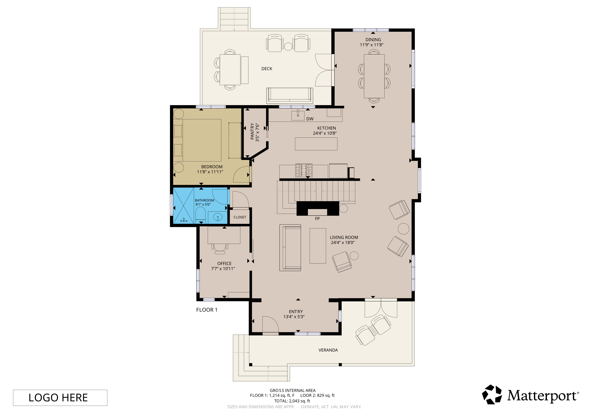
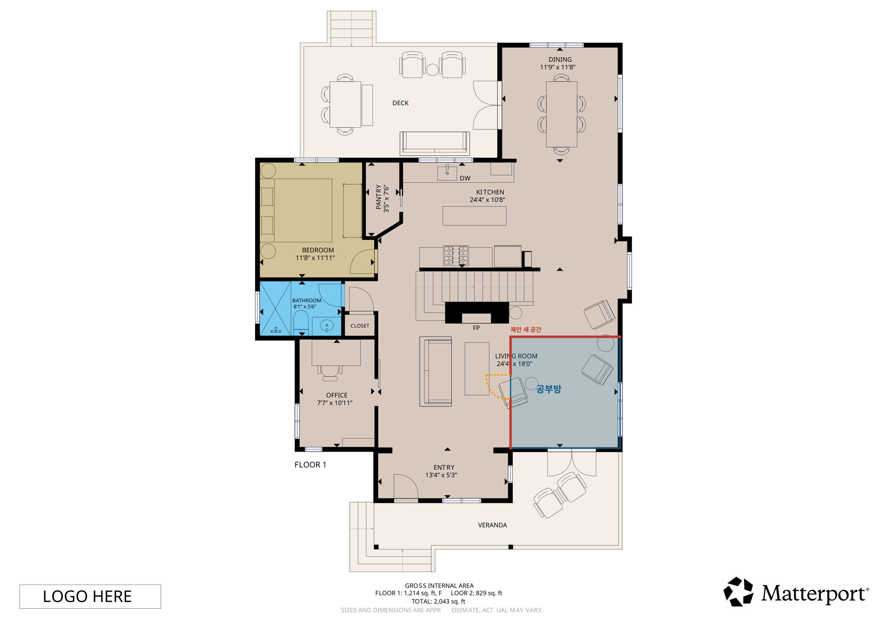
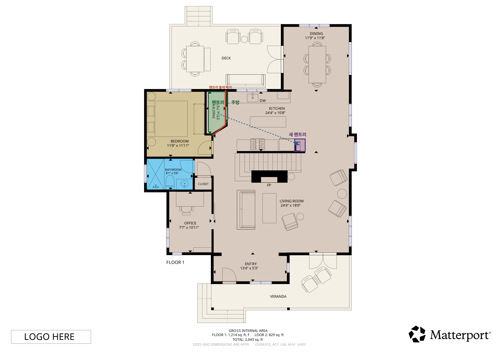
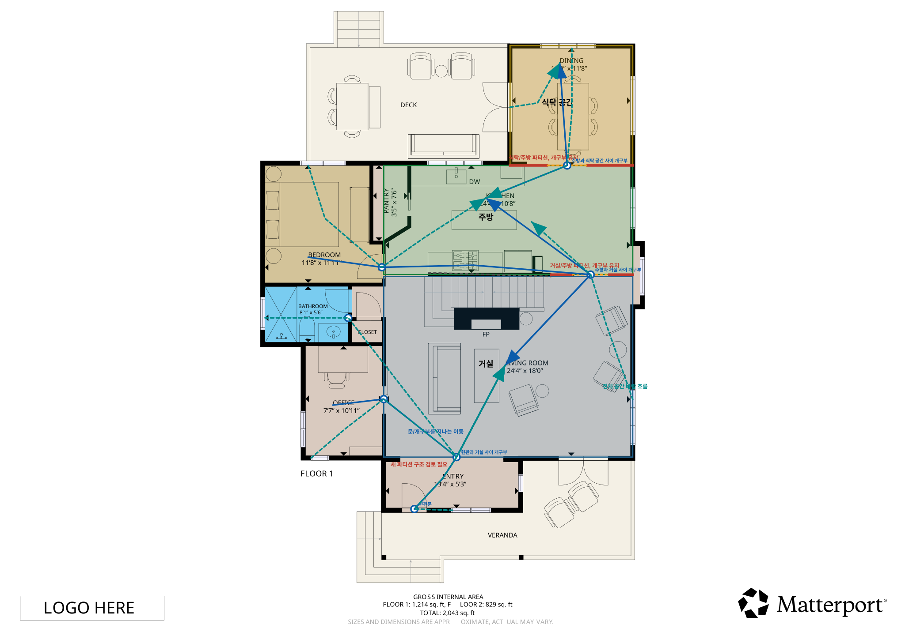

# 공사 요청 3건 비교

이 예시는 같은 원본 SVG 평면도에서 세 가지 자연어 공사 요청을 실행한 결과를 비교합니다.

## 원본 도면

## 비교표

| 항목 | 요청 1: 공부방 분할 | 요청 2: 팬트리/주방 재구성 | 요청 3: 주방/식탁/거실 분리 |
| --- | --- | --- | --- |
| 사용자 요청 | 거실 일부를 공부방으로 만들되 출입구는 막지 않음 | 기존 팬트리를 주방으로 전환하고 팬트리는 주방 가까이에 재배치 | 주방과 식탁을 별도 공간으로, 거실은 독립 공간으로 구성 |
| 주요 변경 | 거실 동쪽 영역에 새 공부방과 내부 문 추가 | 팬트리 둘레를 제거하고 키 큰 팬트리 수납장을 주방 가까이에 배치 | 주방/식탁, 주방/거실 사이에 개구부가 있는 파티션 추가 |
| 동선 고려 | 현관 하부 동선 유지 | 침실문, 식탁 접근, 현관 동선 유지 | 이동 화살표가 문/개구부 waypoint를 통과 |
| 바람/채광 고려 | 공부방을 외부 창가에 배치 | 외부 창을 막지 않는 수납장 재배치 | 전체 공간 바람 흐름을 qualitative proxy로 표시 |
| 확정하지 않는 것 | 구조벽, 법규, 설비, 인허가 | 배관/전기/공조/구조 검토 | CFD, 실제 풍량, 보행 시뮬레이션 |

## 요청 1: 거실 일부를 공부방으로 분할

생성 파일:

- [study_room_report.html](../examples/fcl-floor1/study_room_report.html)
- [study_room_proposal.json](../examples/fcl-floor1/study_room_proposal.json)

## 요청 2: 팬트리를 주방으로 전환하고 팬트리 재배치

생성 파일:

- [kitchen_pantry_report.html](../examples/fcl-floor1/kitchen_pantry_report.html)
- [kitchen_pantry_proposal.json](../examples/fcl-floor1/kitchen_pantry_proposal.json)

## 요청 3: 주방, 식탁 공간, 거실 분리 + 동선/바람 표시

생성 파일:

- [zoned_living_kitchen_dining_report.html](../examples/fcl-floor1/zoned_living_kitchen_dining_report.html)
- [zoned_living_kitchen_dining_proposal.json](../examples/fcl-floor1/zoned_living_kitchen_dining_proposal.json)

## 해석 원칙

- 공사 제안은 도면 기반 추론입니다.
- 구조 안전, 설비, 법규, 견적, 인허가는 별도 전문가 검토 대상입니다.
- 불확실한 문/창문/통풍 추론은 확정하지 않고 검토 필요 상태로 남겨야 합니다.
